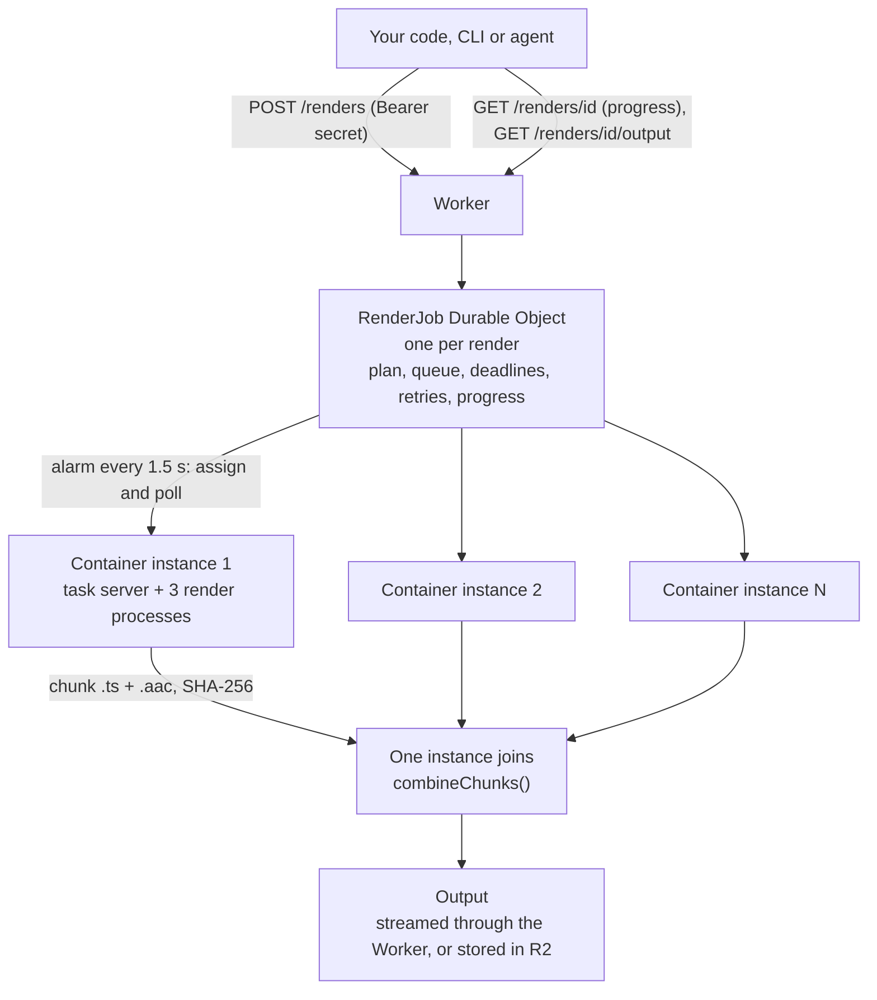

# Render Remotion and HyperFrames on Cloudflare Containers

A working guide, with code, for rendering video that is written as code on
[Cloudflare Containers](https://developers.cloudflare.com/containers/), as an alternative to AWS Lambda and Vercel
Sandbox.

- **Remotion**: server-side rendering of a composition, split into chunks over several container instances and
  joined with `combineChunks()`.
- **HyperFrames**: its own renderer in a container.
- **Both in one video**: a HyperFrames layer inside a Remotion composition.

It is for people who write video with [Remotion](https://www.remotion.dev) or
[HyperFrames](https://github.com/heygen-com/hyperframes), often through AI coding agents with the Remotion or
HyperFrames skills, and who want a cloud render of **their own code on their own Cloudflare account**. Agents:
read [AGENTS.md](AGENTS.md).

This is a community guide. It is not made or endorsed by Remotion, HeyGen or Cloudflare.

## Status

Written and tested in November 2026 with Remotion 4.0.530, HyperFrames 0.9.103, wrangler 4.169.0.

| | Local, Node | Local, Docker (Linux x86-64) | Cloudflare `standard-4` |
| --- | --- | --- | --- |
| Remotion: one instance | tested | tested | tested |
| Remotion: chunked over instances | tested (2) | tested (2) | tested (4 instances, 12 chunks) |
| Remotion: still, web font, WebGL | tested | WebGL tested | tested |
| HyperFrames | tested | tested | tested |
| Mixed | tested | tested | tested |
| Chunks and output through R2 | | | tested |
| Presigned download URLs | | | **not run**: written from the docs |
| `wrangler deploy` building the image with local Docker | | | **not run**: we pushed prebuilt images ([why](docs/daemonless-deploy.md)) |

"Tested" means: rendered, frame count and duration checked, sound checked at every join, frames looked at.
Details and everything that is not tested: [Limits and known problems](#limits-and-known-problems).

## Which example do I need?

| Your video is | Example | Renderer | Chunked? |
| --- | --- | --- | --- |
| Pure Remotion (React components, `<Composition>`) | [`examples/remotion-only`](examples/remotion-only) | `@remotion/renderer`: `selectComposition()` + `renderMedia()` | yes, H.264 |
| Pure HyperFrames (HTML, CSS, GSAP timeline) | [`examples/hyperframes-only`](examples/hyperframes-only) | `hyperframes render` | no: one instance per video |
| Remotion with a HyperFrames-made layer | [`examples/mixed`](examples/mixed) | HyperFrames renders the layer to a WebM with alpha, Remotion composites it | yes, like Remotion |
| HyperFrames with a Remotion-made layer | described in [docs/mixed.md](docs/mixed.md), not built | Remotion renders the layer, HyperFrames uses it as a `<video>` | no |

The three examples are separate folders with their own dependencies, image and service. They share one coordinator.

## Quick start

Needs Node 22.18 or newer and FFmpeg (for HyperFrames and for the checks). No Cloudflare account yet.

```bash
git clone https://github.com/proSamik/render-remotion-hyperframes-cloudflare
cd render-remotion-hyperframes-cloudflare
npm run setup                      # installs the root and the three examples
npm run local:remotion             # examples/remotion-only/out/local.mp4
npm run local:hyperframes          # examples/hyperframes-only/out/local.mp4
npm run local:mixed                # examples/mixed/out/local.mp4
```

Then on Cloudflare (Workers Paid plan, `npx wrangler login`, Docker running):

```bash
cd examples/remotion-only
npm run deploy                                                        # bundles, builds the image, deploys; prints the URL
openssl rand -hex 24 | tee /dev/stderr | npx wrangler secret put RENDER_SECRET
export RENDER_SERVICE_URL=https://rrh-remotion-only.<your-subdomain>.workers.dev RENDER_SECRET=<the value just printed>
npm run cloud                                                         # out/cloud.mp4, rendered on 2 instances
```

Each example has the same three ways to run:

| | Remotion only | HyperFrames only | Mixed |
| --- | --- | --- | --- |
| Node, no Docker | `npm run local` | `npm run local` | `npm run local` |
| Docker | `npm run docker:build && npm run docker` | same | same |
| Cloudflare | `npm run deploy`, then `npm run cloud` | same | same |

More control (Remotion and mixed):

```bash
node packages/cloudflare-containers/bin/remotion-cloudflare.mjs render Shapes \
  --props='{"title":"Hello","durationInSeconds":60}' --concurrency=4 --out=out/hello.mp4
```

Check any result:

```bash
node packages/core/scripts/verify.mjs out/hello.mp4 --frames 1800
```

## How it works



1. The Worker checks the secret and creates one Durable Object per render.
2. That object asks a container for the composition's size, frame rate and length, and plans equal chunks.
3. It starts container instances. Each instance runs a small task server and renders up to 3 chunks at once, each
   in its own process.
4. Every 1.5 seconds it polls the instances: frames done, tasks lost, deadlines passed. It re-queues what failed.
5. Finished chunks go to one instance (directly with a checksum, or through R2), which joins them.
6. You poll progress, download the file, and delete the render.

The coordinator is a plain state machine (`packages/core/src/coordinator.ts`, about 350 lines). The same code runs
in the Durable Object and in a local loop, which is how `npm run local` and `npm run docker` work, and how its unit
tests simulate failures.

## Repository layout

```
packages/
  core/                     engine-neutral: coordinator, task server (runs in the container), Worker, client, local runner
  cloudflare-containers/    remotion-cloudflare-containers: the Remotion engine, an API shaped like @remotion/lambda, a CLI
  hyperframes-engine/       the HyperFrames engine
examples/
  remotion-only/            compositions + Dockerfile + wrangler.jsonc
  hyperframes-only/         composition + Dockerfile + wrangler.jsonc
  mixed/                    Remotion composition + HyperFrames layer + Dockerfile + wrangler.jsonc
docs/                       one page per topic; docs/cloudflare/ is written like Remotion's own docs
```

## The Remotion package

`packages/cloudflare-containers` has the vocabulary of Remotion's own cloud packages:

```ts
import { deploySite, deployService } from 'remotion-cloudflare-containers';
import { renderMediaOnCloudflare, getRenderProgress, downloadMedia, deleteRender, estimatePrice } from 'remotion-cloudflare-containers/client';

const { renderId } = await renderMediaOnCloudflare({ composition: 'Shapes', inputProps: { title: 'Hi', durationInSeconds: 60 }, concurrency: 4 });
```

It is unofficial, not on npm, and not in the `@remotion/` scope. Docs in Remotion's page layout:
[docs/cloudflare](docs/cloudflare/index.md). What separates it from an upstream package:
[UPSTREAMING.md](UPSTREAMING.md).

## Cost and speed

Measured in November 2026 on Cloudflare `standard-4` (4 vCPU, 12 GiB), 1920x1080 at 30 fps, list prices. **Your
numbers will differ**: content decides almost everything.

This repository's small examples, cold start and join included:

| Render | Instances | Wall time | Cost |
| --- | --- | --- | --- |
| Remotion `Shapes`, 10 s | 1 | 30 s | $0.0016 |
| Remotion `Shapes`, 60 s | 4 | 32 s | $0.0069 |
| Remotion `Cube` (three.js), 20 s | 1 | 53 s | $0.0046 |
| HyperFrames example, 8 s | 1 | 17 s | $0.0011 |
| Mixed example, 8 s | 2 | 35 s | $0.0027 |

Heavier, real content, measured earlier on the same platform while building the renderer of the
[Subclip](https://subclip.app) video editor (render only):

| Content | $ per output minute |
| --- | --- |
| Camera footage with captions | 0.011 |
| The same, 10 minutes on 8 instances (193 to 241 s wall time) | 0.007 to 0.009 |
| Motion graphics | 0.020 |
| A 3D model in WebGL, on Mesa llvmpipe | 0.044 |
| The same on SwiftShader | 0.127 |

Method: CPU seconds are the virtual machine's busy time from `/proc/stat` while it works; cost is
`cpuSeconds x $0.000020 + instanceSeconds x $0.0000314`. We did not compare this with the Cloudflare bill. Every
render reports its own numbers. Full tables, what is left out, and how to measure your own:
[docs/costs.md](docs/costs.md).

## Compared with Remotion Lambda, Cloud Run and Vercel Sandbox

Prices and statements read on 2026-11-27. We ran nothing on AWS, Google Cloud or Vercel.

| | Remotion Lambda | Remotion Cloud Run | Remotion on Vercel Sandbox | This guide on Cloudflare Containers |
| --- | --- | --- | --- | --- |
| Who maintains it | Remotion; their recommendation for most people [1] | Remotion; "not being actively developed", alpha [2] | Remotion; experimental [3] | you, starting from this repository |
| Distributed rendering | yes, up to 200 functions per render | no | no | yes, H.264, as many instances as you allow |
| Published speed | 10 minutes of HD video in about 1 minute [4] | | | 60 s in 32 s on 4 instances (light content); 10 min in 193 to 241 s on 8 (footage) |
| Compute price | $0.0000133334 per GB-second (arm64, us-east-1) [5]; at 2048 MB that is about $0.000023 per vCPU-second | per vCPU-second and GiB-second of the service | "based on usage. You only pay for the time the VM is running" [1] | $0.000020 per active vCPU-second + $0.0000025 per GiB-second + disk [6] |
| Published cost examples | 1-minute video $0.017, 10-minute HD video $0.103 (compute only) [4] | | | $0.007 to $0.044 per output minute by content (ours) |
| Storage egress | S3: $0.09 per GB [5] | | Vercel Blob | R2: no egress fee [7] |
| Longest render | 15 minutes per function, videos are split [8] | request timeout | 45 minutes (Hobby), 5 hours (Pro) [3] | no fixed limit per instance |
| Cold start | about a second per function | | longer [1] | seconds; 1 to 2 minutes when the image is pulled at a new location (measured) |
| GPU | no | no | no | no |
| GL backend | `swangle` by default | `swangle` by default | pass-through | yours to choose per chunk |
| Fonts | Lambda layer fonts, web fonts | web fonts | web fonts | your image |
| HyperFrames | no (HyperFrames has its own `hyperframes lambda`) | no (`hyperframes cloudrun`) | | yes, and mixed |
| Webhooks, expiring renders, other language clients | yes | partly | no | no |
| Remotion licence | the same on all four | | | |

Sources:
[1] https://www.remotion.dev/docs/compare-ssr
[2] https://www.remotion.dev/docs/cloudrun/status
[3] https://www.remotion.dev/docs/vercel-sandbox
[4] https://www.remotion.dev/docs/lambda/cost-example
[5] https://aws.amazon.com/lambda/pricing/ and https://aws.amazon.com/s3/pricing/
[6] https://developers.cloudflare.com/containers/platform/pricing/
[7] https://developers.cloudflare.com/r2/pricing/
[8] https://www.remotion.dev/docs/lambda/limits

Our reading: if you want the path Remotion maintains, or the fastest possible render, use Lambda. Use this when you
want to stay on Cloudflare, want HyperFrames or a mix in the same place, or want to control the image. You take on
the operation of it.

## Licences

**Read this before you build a product on it.**

### Remotion is not MIT

Remotion is source-available with its own licence (https://www.remotion.dev/docs/license,
https://github.com/remotion-dev/remotion/blob/main/LICENSE.md). Quoted from those pages on 2026-11-27:

- "You are eligible to use Remotion for free if you are: an individual / a for-profit organization with up to 3
  employees / a non-profit or not-for-profit organization / evaluating whether Remotion is a good fit, and are not
  yet using it in a commercial way"
- "You are required to obtain a Company License to use Remotion if you are not within the group of entities eligible
  for a Free License."
- Pricing: "Remotion for Automators: $0.01 per render, charged in increments of 1000 renders ($10), with a minimum
  of $100 per month." (https://www.remotion.dev/docs/license/pricing)

Where you render does not change this. The licence is the same on Lambda, on your laptop and here.

### You may not run a render service for other people's Remotion code

From Remotion's terms (https://www.remotion.dev/docs/terms):

- "It is not allowed to operate a rendering service that allows end-users to bring or upload their own Remotion
  code. Offering a rendering service in this way might obscure the fact that Remotion needs to be licensed, and any
  such rendering service requires prior explicit and written approval from Remotion."
- "It is not allowed to offer a cloud rendering service that enables end-users to upload their own Remotion projects
  and render media out of them."
- Allowed: "It is acceptable to allow third parties to render videos through a service if those third-party users
  modify parameters of hosted Remotion code (i.e., an abstraction layer on top of the Remotion Software is given)."

That is why this guide bakes **your** bundle into **your** image and accepts only a composition name and input
props. Keep it that way. If you want something else, ask Remotion first.

One open point: the pages we read do not say whether a self-hosted render made of many `renderMedia()` calls and one
`combineChunks()` counts as one render for the company licence. Ask Remotion if you are under that licence.

### HyperFrames

Apache License 2.0 (the `LICENSE` file of https://github.com/heygen-com/hyperframes). It needs FFmpeg, which has its
own licences. The example compositions load GSAP from a CDN; GSAP has its own licence
(see https://gsap.com).

### This repository

MIT, see [LICENSE](LICENSE). That covers the code and text here. It does not change the licence of Remotion,
HyperFrames, FFmpeg, GSAP or Chromium. The font Archivo Black in the examples is under the SIL Open Font License 1.1.

## Security

- Every request needs `Authorization: Bearer <RENDER_SECRET>`. Without a secret the service refuses everything.
- The service URL is public. The secret is all that stands between the Internet and your bill. Do not expose it to
  browsers. There is no rate limit and no queue.
- `MAX_INSTANCES_PER_RENDER` caps one render. Nothing caps the number of renders.
- Do not run other people's code: the browser runs without its sandbox, and the only isolation is the instance
  (one micro virtual machine per instance, never shared between renders).
- No secrets in the image. The containers get no Cloudflare credentials; with R2 they reach only their own render's
  objects, through the Worker.

More: [docs/security.md](docs/security.md).

## Documentation

| Topic | Page |
| --- | --- |
| Chunking and joins, audio included | [docs/chunking.md](docs/chunking.md) |
| GL backends | [docs/gl-backends.md](docs/gl-backends.md) |
| Fonts | [docs/fonts.md](docs/fonts.md) |
| Cold starts and warm instances | [docs/cold-starts.md](docs/cold-starts.md) |
| Failures and retries | [docs/failures.md](docs/failures.md) |
| Concurrency and many jobs at once | [docs/concurrency.md](docs/concurrency.md) |
| Progress reporting | [docs/progress.md](docs/progress.md) |
| R2 and presigned URLs | [docs/r2.md](docs/r2.md) |
| Costs and how to measure your own | [docs/costs.md](docs/costs.md) |
| Mixing the two frameworks | [docs/mixed.md](docs/mixed.md) |
| Using this from an AI coding agent | [docs/agents.md](docs/agents.md), [AGENTS.md](AGENTS.md) |
| Security | [docs/security.md](docs/security.md) |
| Troubleshooting | [docs/troubleshooting.md](docs/troubleshooting.md) |
| Deploying without local Docker | [docs/daemonless-deploy.md](docs/daemonless-deploy.md) |
| The Remotion package, in Remotion's docs layout | [docs/cloudflare](docs/cloudflare/index.md) |
| Existing work we looked at | [docs/existing-work.md](docs/existing-work.md) |

## Troubleshooting, in short

| Symptom | Likely cause |
| --- | --- |
| `403 forbidden` | secret missing, wrong, or shorter than 16 characters |
| Text invisible or in another font | the font is not in the image: [fonts](docs/fonts.md) |
| `error is not a function` at `new WebGLRenderer` | no WebGL with that GL backend: use `--webgl` |
| HyperFrames: `Chrome not found` on Cloudflare only | set `HYPERFRAMES_BROWSER_PATH`; the example Dockerfiles do |
| Stuck in `planning` right after the first deploy | the image is still being distributed; wait a few minutes |
| `410` on download | the instance with the output stopped; download sooner or attach R2 |
| `Unknown file extension ".ts"` | a Node build without TypeScript support; run `npm install` in the root |

More: [docs/troubleshooting.md](docs/troubleshooting.md).

## Limits and known problems

Honest list. Read it before you depend on this.

- **Young code.** Written in November 2026 and run a few dozen times on one account, with at most 4 instances in
  this code base. The larger numbers (8 instances, 10 minutes, 93 jobs) come from an earlier private prototype with
  the same design.
- **Cloudflare's API is moving.** This uses the Durable Object Container API with the `durable_object` scheduling
  policy, which Cloudflare calls a public beta. The `Container` class from `@cloudflare/containers`, which most
  existing examples use, is called deprecated in Cloudflare's docs as of November 2026.
- **Not run:** presigned URLs; `wrangler deploy` building the image on the same machine; outputs above 100 MiB
  (the multipart upload ran only with its threshold lowered to 8 MiB); more than 4 instances; videos longer than 90
  seconds; HyperFrames as the host of a mix; Google Fonts loaded by Remotion at render time; `https://` serve URLs.
- **The failure handling was not triggered by a real failure in this code base.** Slow starts, hanging chunks,
  restarts and damaged transfers happened in the earlier prototype. Here they are reproduced by unit tests against a
  simulated fleet.
- **No queue, no rate limit, no webhooks.**
- **Only H.264 is chunked.** HyperFrames is not chunked at all.
- **Without R2 the output lives on one instance** for at most 15 minutes after the render.
- **A constant audio offset of about 45 ms** in Remotion renders of the example, chunked or not. It does not grow.
  We did not find its cause.
- **Hosts differ.** The same chunk took 93 to 191 s on eight instances of one earlier run.
- **`angle-egl` (the cheap WebGL path for heavy scenes) does not work with the browser Remotion ships.** See
  [docs/gl-backends.md](docs/gl-backends.md).
- **Images are large**: 1.3 to 2.1 GB uncompressed.
- **TypeScript is run directly by Node.** There is no build step and nothing is published to npm.

## Existing work

Others have done parts of this. The ones we read, and what we took from them:
[docs/existing-work.md](docs/existing-work.md). In short: Remotion has an official single-container proof of concept;
HeyGen has an official HyperFrames template for Cloudflare; one community repository renders Remotion in chunks on
Cloudflare. None covers HyperFrames and Remotion together.

## Contributing

See [CONTRIBUTING.md](CONTRIBUTING.md). Reports of what broke for you are the most useful contribution.
