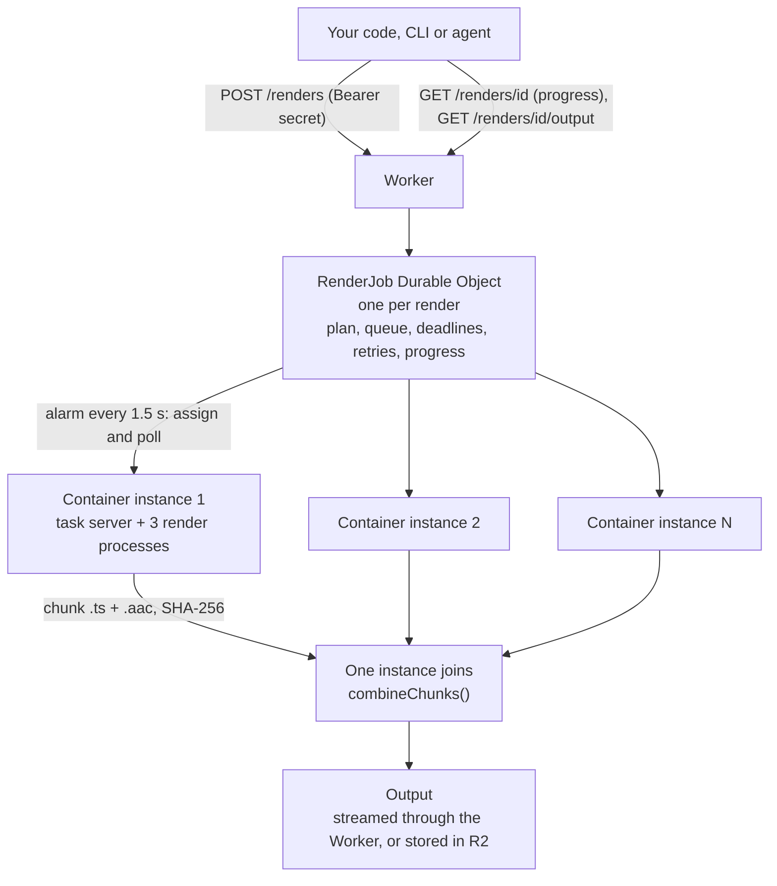

# Render Remotion and HyperFrames on Cloudflare Containers

A working guide, with code, for rendering video that is written as code on
[Cloudflare Containers](https://developers.cloudflare.com/containers/), as an alternative to AWS Lambda and Vercel
Sandbox.

- **Remotion**: server-side rendering of a composition, split into chunks over several container instances and
  joined with `combineChunks()`.
- **HyperFrames**: split into chunks over several container instances with HyperFrames' own distributed renderer,
  joined without a re-encode, one audio mix for the whole video. Or its CLI in one piece.
- **Both in one video**: a HyperFrames layer inside a Remotion composition.

It is for people who write video with [Remotion](https://www.remotion.dev) or
[HyperFrames](https://github.com/heygen-com/hyperframes), often through AI coding agents with the Remotion or
HyperFrames skills, and who want a cloud render of **their own code on their own Cloudflare account**. Agents:
read [AGENTS.md](AGENTS.md).

This is a community guide. It is not made or endorsed by Remotion, HeyGen or Cloudflare.

**Licence, in one paragraph.** You deploy this to your own Cloudflare account and render your own Remotion /
HyperFrames code. Remotion's licence applies to you as the deployer (free for individuals and companies up to 3
people; larger companies need a Remotion company licence). Don't turn your deployment into a service where other
people upload their own Remotion code; Remotion's licence doesn't allow that without their approval. Details and
quotes: [Licences](#licences).

## What we observed

One 1:44:00 mixed project (HyperFrames, Remotion, 3D, footage) rendered at 1080p30, per job, list prices,
November 2026. Cloudflare numbers are **measured** (by the private implementation of this design, see
[Status](#status)); AWS numbers are **estimated** (nothing was run on AWS).

| | Cloudflare | AWS Lambda + S3 |
|---|---|---|
| Compute (Standard tier) | $2.13 (measured) | $1.47 – $2.50 (estimated) |
| Container egress (chunks + final file, 16.2 GB measured) | $0 within the 1 TB/month included (NA/EU), $0.41 above it at $0.025/GB | $0 (Lambda → S3 in the same region) |
| User downloads the 8 GB final video | $0 (R2 has no egress fee) | ~$0.67 ($0.09/GB) |
| Storage + requests | ~$0.10 | ~$0.03 |
| Idle warm instances after the job (memory + disk only) | up to ~$0.03 (4 instances kept 240 s, if no job reuses them) | $0 |
| Total | $2.23; ~$2.64 above 1 TB/month, ~$2.67 with idle warm time | $2.17 – $3.20 |

Roughly a tie. Cloudflare is equal or a bit cheaper per job, and clearly cheaper when users download the result more
than once (R2 has no egress fee). Two costs are easy to miss: **container egress is billed beyond the monthly
allowance**, and **idle warm instances bill memory and disk**. We tested routing the containers' uploads through the
Worker's R2 binding (an outbound handler) instead of the public R2 endpoint: Cloudflare's usage analytics counted
those bytes as container egress byte for byte, so it does not save egress ([costs](docs/costs.md#container-egress)).
Per-tier tables follow; resolution and smaller examples are further down in [Cost and speed](#cost-and-speed).


### A 1:44:00 project on four speed tiers

A 1:44:00 mixed test project (HyperFrames, Remotion, 3D, footage), 187,200 frames at 1920x1080 and 30 fps, rendered
from a cold start by the prototype of this design through R2 with presigned URLs, November 2026. Durations are
h:mm:ss or mm:ss.

Table 1, Cloudflare, **measured**:

| Tier | Video length | Project size | Final video | Upload (hash + plan + upload) | Render (start to download link) | Download | Total | Cloudflare cost (compute + R2) |
| --- | --- | --- | --- | --- | --- | --- | --- | --- |
| Standard | 1:44:00 | 1.89 GB | 7.99 GB | 5:49 | 7:36 | 19:35 | 33:18 | $2.23 |
| Fast | 1:44:00 | 1.89 GB (already in R2) | 7.69 GB | 0:12 | 6:33 | 21:16 | 28:28 | $2.50 |
| Economy | 1:44:00 | 1.89 GB (already in R2) | 8.15 GB | 0:17 | 12:46 | 19:55 | 33:17 | $2.10 |
| Saver | 1:44:00 | 1.89 GB (already in R2) | 8.15 GB | 0:12 | 18:15 | 21:25 | 40:13 | $1.71 |

Table 2, the same jobs on AWS, **estimated** (nothing was run on AWS):

| Tier | Remotion Lambda compute, low to high | S3 egress of the final video | S3 storage + requests | AWS total | Cloudflare (measured) |
| --- | --- | --- | --- | --- | --- |
| Standard | $1.47 to $2.50 | $0.67 | about $0.03 | $2.17 to $3.20 | $2.23 |
| Fast | $1.59 to $2.70 | $0.64 | about $0.03 | $2.26 to $3.37 | $2.50 |
| Economy | $1.45 to $2.46 | $0.68 | about $0.03 | $2.16 to $3.17 | $2.10 |
| Saver | $1.20 to $2.04 | $0.68 | about $0.03 | $1.91 to $2.75 | $1.71 |

Notes:

* The Cloudflare column has no container egress in it: about 16 GB per job (chunks and the final file, sent by the
  containers to R2), $0 inside the account's monthly allowance, about $0.40 above it. See [What we observed](#what-we-observed).
* Upload is 0:12 to 0:17 on the later runs because inputs are content-addressed and were already in R2.
* Download is limited by the test machine's line (about 6 to 7 MB/s). R2 has no egress fee.
* Lambda compute = the measured vCPU-seconds x $0.000023 per vCPU-second (2048 MB functions, arm64, us-east-1, list
  price: $0.0000133334 per GB-second, 1.158 vCPU per function). High = x 1.7 for the SwiftShader (`swangle`) penalty
  that Lambda's forced GL backend adds; low = no penalty. S3 egress at $0.09 per GB.
* Not included on the AWS side: functions reading the inputs from S3 also count as data transfer according to
  Remotion's documentation (at least $0.17 for 1.89 GB read once).
* Honest reading: Cloudflare is cheaper by up to about a third on this job. It saves the $0.65 to $0.70 of egress
  and the `swangle` penalty, but pays for provisioned memory ($0.60 to $0.91 here), so with no penalty Lambda
  roughly ties.

## Why Cloudflare

Cost is roughly a tie (above). Choose Cloudflare for the developer experience, not for a big saving:

- **AWS**: new accounts start with reduced Lambda limits ("New AWS accounts have reduced concurrency and memory quotas
  for Lambda Functions", https://docs.aws.amazon.com/lambda/latest/dg/gettingstarted-limits.html). The default of
  1,000 concurrent executions per region is reached only as AWS raises the quota with use, or after a request in
  the Service Quotas console. Setting up Lambda, S3, IAM roles and policies, regions and quotas through the console
  is a lot to learn for a first deployment.
- **Cloudflare**: everything is set up and deployed with the wrangler CLI: one config file (`wrangler.jsonc`),
  `wrangler deploy`, `wrangler secret put`, `wrangler r2 bucket create`. The bill is short and readable (CPU,
  memory, disk, egress per product) and budget alerts are simple to set in the dashboard. R2 has no egress fee for
  downloads. Container account limits are generous by default (15,000 concurrent vCPU, 60 TiB memory, 300 TB disk
  per account) and "To request higher limits, contact your account team or Cloudflare Support"
  (https://developers.cloudflare.com/containers/platform/limits/).
- The Remotion licence is the same on both: see [Licences](#licences).


## Status

Written and tested in November 2026 with Remotion 4.0.530, HyperFrames 0.9.103, wrangler 4.169.0.

| | Local, Node | Local, Docker (Linux x86-64) | Cloudflare `standard-4` |
| --- | --- | --- | --- |
| Remotion: one instance | tested | tested | tested |
| Remotion: chunked over instances | tested (2) | tested (2) | tested (4 instances, 12 chunks) |
| Remotion: still, web font, WebGL | tested | WebGL tested | tested |
| HyperFrames (CLI, one piece) | tested | tested | tested |
| HyperFrames split into chunks over instances | tested (up to 8 local instances; CI on Linux) | **not run** | **not run** |
| Mixed | tested | tested | tested |
| Chunks and output through R2 (Worker gateway) | | | tested |
| Streaming join (`--stitch=stream`, `stream-fmp4`) | tested: same file as `combineChunks()` | | **not run** |
| Chunks and output over presigned URLs (`R2_DIRECT`) | tested against an S3 stand-in in memory | | **not run** here; verified for real in the prototype ([docs/r2.md](docs/r2.md)) |
| Presigned download URLs | | | **not run** here: written from the docs; same presigner |
| `wrangler deploy` building the image with local Docker | | | **not run**: we pushed prebuilt images ([why](docs/daemonless-deploy.md)) |

"Tested" means: rendered, frame count and duration checked, sound checked at every join, frames looked at.
Details and everything that is not tested: [Limits and known problems](#limits-and-known-problems).

**The Cloudflare column was measured with version 0.1.0.** The version after it changed the coordinator, the task
server and the Worker (hedging rule, one set of files per run, checked transfers, streaming join: see the
[changelog](CHANGELOG.md)). Those changes ran locally on macOS, with every example and 39 unit tests; CI
runs the same checks on Linux. They have not been deployed to Cloudflare from this code base yet. The lessons behind them come from a private
prototype of the same design that did run there, on up to 292 instances; where a number on these pages is the
prototype's, the page says so.

## Which example do I need?

| Your video is | Example | Renderer | Chunked? |
| --- | --- | --- | --- |
| Pure Remotion (React components, `<Composition>`) | [`examples/remotion-only`](examples/remotion-only) | `@remotion/renderer`: `selectComposition()` + `renderMedia()` | yes, H.264 |
| Pure HyperFrames (HTML, CSS, GSAP timeline) | [`examples/hyperframes-only`](examples/hyperframes-only) | `@hyperframes/producer/distributed` per chunk; `hyperframes render` for other formats | yes, H.264 MP4, any chunk lengths |
| Remotion with a HyperFrames-made layer | [`examples/mixed`](examples/mixed) | HyperFrames renders the layer to a WebM with alpha, Remotion composites it | yes, like Remotion |
| HyperFrames with a Remotion-made layer | described in [docs/mixed.md](docs/mixed.md), not built | Remotion renders the layer, HyperFrames uses it as a `<video>` | no |

The three examples are separate folders with their own dependencies, image and service. They share one coordinator.

## Quick start

Needs Node 22.18 or newer and FFmpeg (for HyperFrames and for the checks). No Cloudflare account yet.

```bash
git clone https://github.com/proSamik/render-remotion-hyperframes-cloudflare
cd render-remotion-hyperframes-cloudflare
npm run setup                      # installs the root and the three examples
npm run local:remotion             # examples/remotion-only/out/local.mp4
npm run local:hyperframes          # examples/hyperframes-only/out/local.mp4
npm run local:mixed                # examples/mixed/out/local.mp4
```

Then on Cloudflare (Workers Paid plan, `npx wrangler login`, Docker running):

```bash
cd examples/remotion-only
npm run deploy                                                        # bundles, builds the image, deploys; prints the URL
openssl rand -hex 24 | tee /dev/stderr | npx wrangler secret put RENDER_SECRET
export RENDER_SERVICE_URL=https://rrh-remotion-only.<your-subdomain>.workers.dev RENDER_SECRET=<the value just printed>
npm run cloud                                                         # out/cloud.mp4, rendered on 2 instances
```

Each example has the same three ways to run:

| | Remotion only | HyperFrames only | Mixed |
| --- | --- | --- | --- |
| Node, no Docker | `npm run local` | `npm run local` | `npm run local` |
| Docker | `npm run docker:build && npm run docker` | same | same |
| Cloudflare | `npm run deploy`, then `npm run cloud` | same | same |

More control (Remotion and mixed):

```bash
node packages/cloudflare-containers/bin/remotion-cloudflare.mjs render Shapes \
  --props='{"title":"Hello","durationInSeconds":60}' --concurrency=4 --out=out/hello.mp4
```

Check any result:

```bash
node packages/core/scripts/verify.mjs out/hello.mp4 --frames 1800
```

## How it works



1. The Worker checks the secret and creates one Durable Object per render.
2. That object asks a container for the composition's size, frame rate and length, and plans equal chunks.
3. It starts container instances. Each instance runs a small task server and renders up to 3 chunks at once, each
   in its own process.
4. Every 1.5 seconds it polls the instances: frames done, tasks lost, deadlines passed. It re-queues what failed.
   Every run of a chunk writes its own files, so a retry or a second run can never overwrite a result.
5. Finished chunks go to one instance (directly, or through R2; with a checksum on every hop), which joins them.
   Remotion: `combineChunks()`. HyperFrames: the chunks' MPEG-TS byte after byte into FFmpeg, video copied, one audio
   mix of the whole timeline under it ([docs/hyperframes-split.md](docs/hyperframes-split.md)).
6. You poll progress, download the file, and delete the render.

The coordinator is a plain state machine (`packages/core/src/coordinator.ts`, under 500 lines). The same code runs
in the Durable Object and in a local loop, which is how `npm run local` and `npm run docker` work, and how its unit
tests simulate failures.

## Repository layout

```
packages/
  core/                     engine-neutral: coordinator, task server (runs in the container), Worker, client, local runner,
                            checked transfers, presigner and signing policy, multipart upload, range proxy, planner
  cloudflare-containers/    remotion-cloudflare-containers: the Remotion engine, an API shaped like @remotion/lambda, a CLI
  hyperframes-engine/       the HyperFrames engine: split rendering (HyperFrames' distributed renderer per chunk, MPEG-TS
                            join, one audio mix) and the CLI path
examples/
  remotion-only/            compositions + Dockerfile + wrangler.jsonc
  hyperframes-only/         composition + Dockerfile + wrangler.jsonc
  mixed/                    Remotion composition + HyperFrames layer + Dockerfile + wrangler.jsonc
docs/                       one page per topic; docs/cloudflare/ is written like Remotion's own docs
```

## The Remotion package

`packages/cloudflare-containers` has the vocabulary of Remotion's own cloud packages:

```ts
import { deploySite, deployService } from 'remotion-cloudflare-containers';
import { renderMediaOnCloudflare, getRenderProgress, downloadMedia, deleteRender, estimatePrice } from 'remotion-cloudflare-containers/client';

const { renderId } = await renderMediaOnCloudflare({ composition: 'Shapes', inputProps: { title: 'Hi', durationInSeconds: 60 }, concurrency: 4 });
```

It is unofficial, not on npm, and not in the `@remotion/` scope. Docs in Remotion's page layout:
[docs/cloudflare](docs/cloudflare/index.md). What separates it from an upstream package:
[UPSTREAMING.md](UPSTREAMING.md).

## Cost and speed

Measured in November 2026 on Cloudflare `standard-4` (4 vCPU, 12 GiB), 1920x1080 at 30 fps, list prices. **Your
numbers will differ**: content decides almost everything.

This repository's small examples, cold start and join included:

| Render | Instances | Wall time | Cost |
| --- | --- | --- | --- |
| Remotion `Shapes`, 10 s | 1 | 30 s | $0.0016 |
| Remotion `Shapes`, 60 s | 4 | 32 s | $0.0069 |
| Remotion `Cube` (three.js), 20 s | 1 | 53 s | $0.0046 |
| HyperFrames example, 8 s | 1 | 17 s | $0.0011 |
| Mixed example, 8 s | 2 | 35 s | $0.0027 |

Split HyperFrames rendering has not run on Cloudflare yet. Locally, on one 8-core Mac with local processes as
instances, the 60 s example went from 0:52 in one chunk to 0:32 in four (light content); with a canvas scene that
fills the CPU by itself it went from 1:50 to 1:41, because four processes on one machine share the same cores. What it
gains on separate instances is not measured: [docs/hyperframes-split.md](docs/hyperframes-split.md#measured).

Heavier, real content, measured earlier on the same platform in the private prototype this design comes from
(render only):

| Content | $ per output minute |
| --- | --- |
| Camera footage with captions | 0.011 |
| The same, 10 minutes on 8 instances (193 to 241 s wall time) | 0.007 to 0.009 |
| Motion graphics | 0.020 |
| A 3D model in WebGL, on Mesa llvmpipe | 0.044 |
| The same on SwiftShader | 0.127 |

### A long real job: one 1:44:00 project on each speed tier

The per-tier tables (Cloudflare measured, AWS estimated) are at the top of this page:
[a 1:44:00 project on four speed tiers](#a-104400-project-on-four-speed-tiers).

### The same project at other output sizes

Same project, Standard tier, inputs already in R2. Output size is one option (`scale` plus a bitrate per size,
[docs/resolution.md](docs/resolution.md)). The download column is the test machine's line, which was slower on these
runs than on the 1080p one.

| Output | Video length | Final video | Upload | Render (start to download link) | Download | Total | Cloudflare cost |
| --- | --- | --- | --- | --- | --- | --- | --- |
| 480p (854 x 480) | 1:44:00 | 2.23 GB | 0:16 | 8:08 | 11:42 | 20:22 | $1.59 |
| 720p (1280 x 720) | 1:44:00 | 4.14 GB | 0:15 | 7:03 | 13:20 | 20:55 | $1.68 |
| 1080p (1920 x 1080) | 1:44:00 | 7.99 GB | 5:49 | 7:36 | 19:35 | 33:18 | $2.23 |
| 2160p (3840 x 2160), first 11 minutes | 11:00 | 2.90 GB | 0:16 | 4:41 | 12:29 | 17:43 | $0.56 |
| 1080p, the same 11 minutes | 11:00 | 0.84 GB | 0:17 | 3:05 | not downloaded | | $0.28 |

Cost is not linear in pixels: 480p cost 71 % of 1080p, and 4K about 2x, because a frame has a fixed part
(React, layout, video seeks, WebGL draw calls) and shader effects cost the same at any size. **Render a fast 480p or
720p preview for approval, then the final**: the preview's file is a quarter to half the size and downloads sooner.
Just do not expect it to cost a fifth.

Method: CPU seconds are the virtual machine's busy time from `/proc/stat` while it works; cost is
`cpuSeconds x $0.000020 + instanceSeconds x $0.0000314`. We did not compare this with the Cloudflare bill. Every
render reports its own numbers. Full tables, what is left out, and how to measure your own:
[docs/costs.md](docs/costs.md).

## Compared with Remotion Lambda, Cloud Run and Vercel Sandbox

Prices and statements read on 2026-11-27. We ran nothing on AWS, Google Cloud or Vercel.

| | Remotion Lambda | Remotion Cloud Run | Remotion on Vercel Sandbox | This guide on Cloudflare Containers |
| --- | --- | --- | --- | --- |
| Who maintains it | Remotion; their recommendation for most people [1] | Remotion; "not being actively developed", alpha [2] | Remotion; experimental [3] | you, starting from this repository |
| Distributed rendering | yes, up to 200 functions per render | no | no | yes, H.264, as many instances as you allow |
| Published speed | 10 minutes of HD video in about 1 minute [4] | | | 60 s in 32 s on 4 instances (light content); 10 min in 193 to 241 s on 8 (footage) |
| Compute price | $0.0000133334 per GB-second (arm64, us-east-1) [5]; at 2048 MB that is about $0.000023 per vCPU-second | per vCPU-second and GiB-second of the service | "based on usage. You only pay for the time the VM is running" [1] | $0.000020 per active vCPU-second + $0.0000025 per GiB-second + disk [6] |
| Published cost examples | 1-minute video $0.017, 10-minute HD video $0.103 (compute only) [4] | | | $0.007 to $0.044 per output minute by content (ours) |
| Storage egress | S3: $0.09 per GB [5] | | Vercel Blob | R2: no egress fee [7] |
| Longest render | 15 minutes per function, videos are split [8] | request timeout | 45 minutes (Hobby), 5 hours (Pro) [3] | no fixed limit per instance |
| Cold start | about a second per function | | longer [1] | seconds; 1 to 2 minutes when the image is pulled at a new location (measured) |
| GPU | no | no | no | no |
| GL backend | `swangle` by default | `swangle` by default | pass-through | yours to choose per chunk |
| Fonts | Lambda layer fonts, web fonts | web fonts | web fonts | your image |
| HyperFrames | no (HyperFrames has its own `hyperframes lambda`) | no (`hyperframes cloudrun`) | | yes, chunked over instances, and mixed |
| Webhooks, expiring renders, other language clients | yes | partly | no | no |
| Remotion licence | the same on all four | | | |

Sources:
[1] https://www.remotion.dev/docs/compare-ssr
[2] https://www.remotion.dev/docs/cloudrun/status
[3] https://www.remotion.dev/docs/vercel-sandbox
[4] https://www.remotion.dev/docs/lambda/cost-example
[5] https://aws.amazon.com/lambda/pricing/ and https://aws.amazon.com/s3/pricing/
[6] https://developers.cloudflare.com/containers/platform/pricing/
[7] https://developers.cloudflare.com/r2/pricing/
[8] https://www.remotion.dev/docs/lambda/limits

Our reading: if you want the path Remotion maintains, or the fastest possible render, use Lambda. Use this when you
want to stay on Cloudflare, want HyperFrames or a mix in the same place, or want to control the image. You take on
the operation of it.

## Licences

**Read this before you build a product on it.**

### Remotion is not MIT

Remotion is source-available with its own licence (https://www.remotion.dev/docs/license,
https://github.com/remotion-dev/remotion/blob/main/LICENSE.md). Quoted from those pages on 2026-11-27:

- "You are eligible to use Remotion for free if you are: an individual / a for-profit organization with up to 3
  employees / a non-profit or not-for-profit organization / evaluating whether Remotion is a good fit, and are not
  yet using it in a commercial way"
- "You are required to obtain a Company License to use Remotion if you are not within the group of entities eligible
  for a Free License."
- Pricing: "Remotion for Automators: $0.01 per render, charged in increments of 1000 renders ($10), with a minimum
  of $100 per month." (https://www.remotion.dev/docs/license/pricing)

Where you render does not change this. The licence is the same on Lambda, on your laptop and here.

### Don't run a service for other people's Remotion code

From Remotion's terms (https://www.remotion.dev/docs/terms):

- "It is not allowed to operate a rendering service that allows end-users to bring or upload their own Remotion
  code. Offering a rendering service in this way might obscure the fact that Remotion needs to be licensed, and any
  such rendering service requires prior explicit and written approval from Remotion."
- "It is not allowed to offer a cloud rendering service that enables end-users to upload their own Remotion projects
  and render media out of them."
- Allowed: "It is acceptable to allow third parties to render videos through a service if those third-party users
  modify parameters of hosted Remotion code (i.e., an abstraction layer on top of the Remotion Software is given)."

That is why this guide bakes **your** bundle into **your** image and accepts only a composition name and input
props. Keep it that way. If you want something else, ask Remotion first.

One open point: the pages we read do not say whether a self-hosted render made of many `renderMedia()` calls and one
`combineChunks()` counts as one render for the company licence. Ask Remotion if you are under that licence.

### HyperFrames

Apache License 2.0 (the `LICENSE` file of https://github.com/heygen-com/hyperframes). It needs FFmpeg, which has its
own licences. The example compositions load GSAP from a CDN; GSAP has its own licence
(see https://gsap.com).

### This repository

MIT, see [LICENSE](LICENSE). That covers the code and text here. It does not change the licence of Remotion,
HyperFrames, FFmpeg, GSAP or Chromium. The font Archivo Black in the examples is under the SIL Open Font License 1.1.

## Security

- Every request needs `Authorization: Bearer <RENDER_SECRET>`. Without a secret the service refuses everything.
- The service URL is public. The secret is all that stands between the Internet and your bill. Do not expose it to
  browsers. There is no rate limit and no queue.
- `MAX_INSTANCES_PER_RENDER` caps one render. Nothing caps the number of renders.
- Do not run other people's code: the browser runs without its sandbox, and the only isolation is the instance
  (one micro virtual machine per instance, never shared between renders).
- No secrets in the image. The containers get no Cloudflare credentials and no storage keys; with R2 they reach only
  their own render's objects, through the Worker or over presigned URLs that the coordinator signs per object.

More: [docs/security.md](docs/security.md).

## Documentation

| Topic | Page |
| --- | --- |
| Chunking and joins, audio included | [docs/chunking.md](docs/chunking.md) |
| Pure HyperFrames split over instances: how, what a composition must do, measurements | [docs/hyperframes-split.md](docs/hyperframes-split.md) |
| GL backends | [docs/gl-backends.md](docs/gl-backends.md) |
| Fonts | [docs/fonts.md](docs/fonts.md) |
| Cold starts and warm instances | [docs/cold-starts.md](docs/cold-starts.md) |
| Failures, retries, hedging, checksums, errors as events | [docs/failures.md](docs/failures.md) |
| Long videos: the streaming join, MP4 and fragmented MP4, disk limits | [docs/long-videos.md](docs/long-videos.md) |
| Output resolution: previews and finals, even sizes, cost per size | [docs/resolution.md](docs/resolution.md) |
| Large inputs: resumable multipart uploads, reading media by range | [docs/inputs.md](docs/inputs.md) |
| Planning a fleet: tiers, cost classes, warm instances, fair sharing | [docs/planning.md](docs/planning.md) |
| Concurrency and many jobs at once | [docs/concurrency.md](docs/concurrency.md) |
| Progress reporting | [docs/progress.md](docs/progress.md) |
| R2, presigned URLs and what to sign | [docs/r2.md](docs/r2.md) |
| Costs and how to measure your own | [docs/costs.md](docs/costs.md) |
| Mixing the two frameworks | [docs/mixed.md](docs/mixed.md) |
| Using this from an AI coding agent | [docs/agents.md](docs/agents.md), [AGENTS.md](AGENTS.md) |
| Security | [docs/security.md](docs/security.md) |
| Troubleshooting | [docs/troubleshooting.md](docs/troubleshooting.md) |
| Deploying without local Docker | [docs/daemonless-deploy.md](docs/daemonless-deploy.md) |
| The Remotion package, in Remotion's docs layout | [docs/cloudflare](docs/cloudflare/index.md) |
| Existing work we looked at | [docs/existing-work.md](docs/existing-work.md) |

## Troubleshooting, in short

| Symptom | Likely cause |
| --- | --- |
| `403 forbidden` | secret missing, wrong, or shorter than 16 characters |
| Text invisible or in another font | the font is not in the image: [fonts](docs/fonts.md) |
| `error is not a function` at `new WebGLRenderer` | no WebGL with that GL backend: use `--webgl` |
| HyperFrames: `Chrome not found` on Cloudflare only | set `HYPERFRAMES_BROWSER_PATH`; the example Dockerfiles do |
| Stuck in `planning` right after the first deploy | the image is still being distributed; wait a few minutes |
| `410` on download | the instance with the output stopped; download sooner or attach R2 |
| `503` with `"selftest": "failed"` | the browser in the image cannot do what `RENDER_SELFTEST` checks: [GL backends](docs/gl-backends.md) |
| Progress waits at one percentage | chunks are rendered again after a restart; the number never goes back: [progress](docs/progress.md) |
| `Unknown file extension ".ts"` | a Node build without TypeScript support; run `npm install` in the root |

More: [docs/troubleshooting.md](docs/troubleshooting.md).

## Limits and known problems

Honest list. Read it before you depend on this.

- **Young code (state on 2026-11-28).** Which numbers come from which code:
  - **This repository's code** has run locally (Node and Docker), in CI on Linux, and on Cloudflare a few dozen
    times on one account, with at most 4 instances per render (version 0.1.0; later versions not yet on
    Cloudflare). The small-example tables in [Cost and speed](#cost-and-speed) are from this code.
  - **A private implementation of the same design** (its own code) produced the larger numbers: the 1:44:00 mixed
    project on four speed tiers and at 360p to 4K, up to 292 instances per job, 7 of 7 failure drills (instance
    killed, cancel, upload resume, token expiry, two users' isolation, failing webhook, corrupted chunk), two users
    rendering at once, about 100 jobs on 2026-11-27 and 28, and the container-egress test of
    [docs/costs.md](docs/costs.md#container-egress). Tables from it say so.
- **The newest changes have not been on Cloudflare.** The measured hedging, the per-run file names, the checked
  downloads, the streaming join, direct transfer over presigned URLs and the self-test hook ran on one Mac, against
  stand-ins, and are checked by CI. The examples on Cloudflare ran with the version before.
- **Cloudflare's API is moving.** This uses the Durable Object Container API with the `durable_object` scheduling
  policy, which Cloudflare calls a public beta. The `Container` class from `@cloudflare/containers`, which most
  existing examples use, is called deprecated in Cloudflare's docs as of November 2026.
- **Not run:** presigned URLs against R2; `wrangler deploy` building the image on the same machine; outputs above
  100 MiB (the multipart upload ran only with its threshold lowered to 8 MiB); more than 4 instances; videos longer
  than 90 seconds; the streaming join on anything longer than 90 frames; HyperFrames as the host of a mix; split
HyperFrames rendering on Cloudflare or in Docker; Google
  Fonts loaded by Remotion at render time; `https://` serve URLs.
- **Helpers that nothing here uses yet.** The multi-user signing policy, the client-side multipart upload, the range
  proxy and the planner in `packages/core` are unit-tested and documented as patterns
  ([inputs](docs/inputs.md), [planning](docs/planning.md)). No example calls them.
- **The failure handling was not triggered by a real failure in this code base.** Slow starts, hanging chunks,
  restarts and damaged transfers happened in the earlier prototype. Here they are reproduced by unit tests against a
  simulated fleet.
- **No queue, no rate limit, no webhooks, no pool of warm instances.**
- **One cost class.** Every chunk runs with the same number of processes per instance. Content that fills an
  instance alone (a heavy shader) should not share one; the service does not know which chunks those are.
- **Only H.264 is chunked.** For HyperFrames that means MP4; WebM, MOV and the other formats render in one piece.
- **Split HyperFrames rendering has run on one Mac and in CI, not on Cloudflare and not in Docker.** Every instance
  plans the composition itself (2 to 3 s for the examples); a shared plan in R2 is not built. The composition must be
  deterministic: time from the timeline, seeded randomness, fonts in the project
  ([docs/hyperframes-split.md](docs/hyperframes-split.md)).
- **Without R2 the output lives on one instance** for at most 15 minutes after the render.
- **The default join needs chunks and output on one disk.** About 85 minutes of 1080p by the prototype's measurement.
  Longer needs `--stitch=stream` or `stream-fmp4`, which have not run on Cloudflare here.
- **A constant audio offset of about 45 ms** in Remotion renders of the example, chunked or not. It does not grow.
  We did not find its cause.
- **Hosts differ.** The same chunk took 93 to 191 s on eight instances of one earlier run.
- **`angle-egl` (the cheap WebGL path for heavy scenes) does not work with the browser Remotion ships.** See
  [docs/gl-backends.md](docs/gl-backends.md).
- **Images are large**: 1.3 to 2.1 GB uncompressed.
- **TypeScript is run directly by Node.** There is no build step and nothing is published to npm.

## Existing work

Others have done parts of this. The ones we read, and what we took from them:
[docs/existing-work.md](docs/existing-work.md). In short: Remotion has an official single-container proof of concept;
HeyGen has an official HyperFrames template for Cloudflare; one community repository renders Remotion in chunks on
Cloudflare. None covers HyperFrames and Remotion together.

## Contributing

See [CONTRIBUTING.md](CONTRIBUTING.md). Reports of what broke for you are the most useful contribution.
