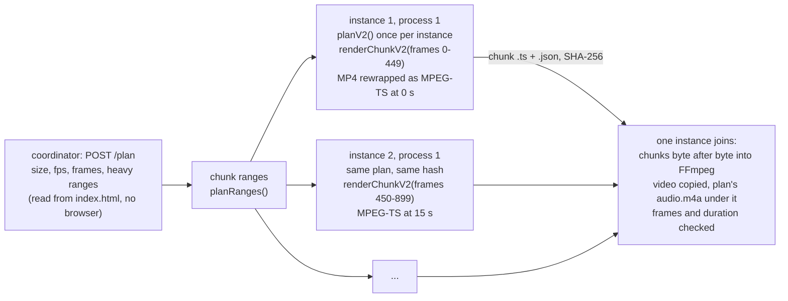

# Split rendering of pure HyperFrames videos

A long HyperFrames video can render on many container instances at once, like a Remotion video: the coordinator cuts
it into frame ranges, each range renders as a chunk in its own process on any instance, and one instance joins the
chunks without encoding the picture again. This page says how that works, what a composition must do for it, and
what was measured.

Code: `packages/hyperframes-engine/split.ts` (render, join), `packages/hyperframes-engine/ranges.ts` (the arithmetic,
unit-tested), `planRanges()` in `packages/core/src/planner.ts` (chunk lengths). Example: `examples/hyperframes-only`.

## Using it

It is on by default for MP4. Ask for chunks the same way as for Remotion:

```bash
cd examples/hyperframes-only
npm run local                                         # 8 s example, 3 chunks on one local instance
npm run local:long                                    # 60 s example, --chunks auto on 2 local instances x 2 processes
npm run local -- --chunks 4 --instances 4 --processes-per-instance 1
npm run cloud:long                                    # on Cloudflare: --chunks auto --instances 4
```

| Option | Where | Meaning |
| --- | --- | --- |
| `--chunks N` | fleet | N chunks of equal length (any length works for HyperFrames, so no short last chunk) |
| `--chunks auto` | fleet | one chunk per render process, chunks of equal cost: heavy ranges shorter (below) |
| `--chunk-seconds min,max[,heavyMax]` | fleet | bounds for `auto` |
| `costWeights` | fleet (HTTP, API) | `{ "heavy": 4, "gl": 1.5 }`: cost of a frame against a light one, for `auto` |
| `--frames-per-chunk N` | fleet | a fixed length, as for Remotion |
| `"split": false` | render | the old way: one `hyperframes render` for the whole video on one instance |
| `"resolution": "480p"` | render | output size, see below |
| `"workers": N` | render | capture browsers per chunk process. Default: the instance's CPUs divided by its processes |
| `"crf": N` | render | x264 CRF instead of the quality's own |

Over HTTP it is the same body as before, plus fleet options:
`{"render":{"project":"long","quality":"draft"},"fleet":{"instances":4,"chunks":"auto"}}`.

Formats other than MP4 (WebM and MOV with alpha, GIF, PNG sequences, HLS) still render in one piece with the CLI.

## How it works



1. **Plan.** The coordinator asks one instance for the composition's size, frame rate and length. The engine reads
   them from the root element's `data-width`, `data-height` and `data-duration`, and finds heavy ranges in the HTML.
   No browser is started for this.
2. **Chunk ranges.** `planRanges()` cuts the job (see "Heavy ranges").
3. **The HyperFrames plan, once per instance.** The first chunk process of a job on an instance runs HyperFrames'
   `planV2()`: it compiles the project, inlines scripts, resolves fonts, probes media and mixes the whole audio
   timeline into one `audio.m4a`. The other processes on that instance wait for it (a lock in the job's folder).
   The project is in the image, so every instance plans the same thing, and HyperFrames' execution-plan hash comes
   out the same. Each chunk records that hash.
4. **A chunk.** `renderChunkV2()` with a `frameRange`: HyperFrames serves the compiled page with its virtual-time
   shim, seeks every frame fresh (never "the next frame after the last one"), captures it in software GL, and encodes
   the range as one closed GOP that starts on an IDR frame, with a keyframe at least every 2 s inside it. The
   resulting MP4 is rewrapped (`-c:v copy`, no re-encode) into MPEG-TS whose timestamps start at
   `startFrame / fps`. A chunk writes `chunk-0003-r1.ts` and `chunk-0003-r1.json` (frames, parts, plan hash, size,
   SHA-256 of the video).
5. **Transfer.** As for Remotion: through the coordinator or through R2, every file checked by SHA-256 on both sides.
6. **Join.** The stitcher plans too (once), then checks every chunk's description before it reads a byte: same plan
   hash, same size and frame rate, chunks meeting end to end, frame counts right. It streams the chunks' MPEG-TS in
   order into one FFmpeg (`-c:v copy`), hashes each chunk on the way and compares with the hash written where it was
   rendered, and puts the plan's single audio track under the picture. At the end it counts the frames FFmpeg wrote
   and the frames in the file, and checks that the video lasts `frames / fps`.

The streaming joins (`--stitch=stream`, `stream-fmp4`) work the same way: each chunk is awaited, checked, read and
deleted in order.

### Why MPEG-TS with absolute timestamps

MPEG-TS can be concatenated byte for byte, which is what makes a streaming join possible. Each chunk carries its own
place on the timeline, so chunks of different lengths join without any grid arithmetic, and a chunk that was rendered
twice (a retry, a hedge) joins the same way. In 90 kHz ticks a frame is exactly 3000 ticks at 30 fps (3750 at 24,
3600 at 25, 1500 at 60), so no rounding builds up across joins.

### Why HyperFrames' own `assembleV2()` is not used

`assembleV2()` joins one output per slice of HyperFrames' own plan. This coordinator plans its own chunks, retries
them, hedges slow ones and joins wherever the chunks are. So HyperFrames' plan here has few long slices (3600 frames),
a coordinator chunk renders a sub-range of one slice (or two parts when it crosses a slice boundary), and the join
does what `assembleV2()` does for H.264 MP4: copy the video, mux the plan's audio.

## Audio: one track, no joins

HyperFrames mixes the audio of the whole timeline once, while it plans. Chunks carry no sound at all. The stitcher
puts that one track under the joined picture:

| Job | What happens to the track |
| --- | --- |
| the whole composition | copied, cut to the video's length with `-t` |
| a frame range (`frameRange`) | decoded from the range's first frame and encoded again (AAC 192 kbit/s), which cuts on the sample |
| no sound in the composition | a silent video |

So there is no audio join to get wrong and nothing can drift: the picture's timestamps are exact frame positions and
the sound is a single continuous stream that starts at frame 0 of the job. This is simpler than Remotion's seamless
AAC chunks (padding, in and out points per chunk), and exact for the same reason HyperFrames' own `assembleV2()` is.

Measured on the 60 s example split into 4 chunks: see [Measured](#measured). Audio and video both last 60.000 s, the
beeps are where they are in the source file, and every flash in the picture begins on the frame of its second.

One trap, found while building this: `-ss 0` on the audio input, with `-c:a copy`, makes FFmpeg drop the AAC
priming information, and the first 9 ms of the output were silent. The copy path therefore cuts with `-t` only.

## What a composition must do

Split rendering renders frame 900 in a different browser, on a different machine, at a different moment than frame
899. Anything that is not a function of timeline time breaks the joins. HyperFrames already freezes the clock while it
captures (its virtual-time shim), and the stitcher refuses chunks planned from different inputs, but the composition
has to play along:

- **Time comes from the timeline.** Drive everything from the GSAP timeline (or `onUpdate` reading the timeline's
  time). No `Date.now()`, `performance.now()`, `requestAnimationFrame` loops that accumulate state, CSS animations
  that run on wall-clock time, or `setTimeout` chains. The example's frame counter and canvas are written this way.
- **No state carried from frame to frame.** A particle system that integrates velocity per rendered frame gives a
  different picture when a chunk starts in the middle. Compute positions from `t` directly, as `long/index.html` does.
- **Seeded randomness.** Use a seeded generator (the example uses mulberry32 with a fixed seed) and draw all random
  numbers once when the page loads, or derive them from the timeline time. Never consume a random stream per frame.
- **Fonts in the project.** Ship font files and declare them with `@font-face` ([fonts.md](fonts.md)). HyperFrames'
  distributed planner refuses compositions whose main font falls back to a system family. Do not draw text into a
  `<canvas>` with a web font: a canvas draws with whatever font is loaded at that moment, which differs between a
  chunk that starts in that scene and one that runs into it. Keep text in the DOM.
- **Media in the project, or at a URL every instance can reach.** The plan probes and, for video, extracts frames.
- **Scripts in the project, not from a CDN.** A script loaded from a CDN is fetched again by every chunk's browser.
  During one local run the machine's network dropped for a moment, every chunk failed with
  `sub_timeline_script_failure ... ERR_INTERNET_DISCONNECTED`, and the job failed after its retries; and a CDN may
  serve another version to another machine. `packages/hyperframes-engine/scripts/vendor-scripts.mjs <project>
  --rewrite` downloads every `<script src="https://...">` into `assets/vendor/`, points `index.html` at the copy and
  writes `vendor.lock.json` (URL and SHA-256 per file). Without `--rewrite` it fetches what the lock lists and refuses
  a file whose hash changed: the examples run it in `npm run assets`, before every local render, check and image
  build. Commit `index.html` and `vendor.lock.json`, not `assets/vendor/`. GSAP has its own licence
  (https://gsap.com/standard-license).
- **A whole-number frame rate** (24, 25, 30, 50, 60). 29.97 renders with `"split": false`.
- **`data-duration` on the root element equal to the timeline's length.** The coordinator plans from it. If
  HyperFrames' plan has fewer frames, the chunk or the join fails with a message that says so.

How to check your own composition: `npm run compare` renders it once in one chunk and once in several and compares
every frame (below).

## Determinism pre-flight

Before a split render the engine reads the project (no browser): `index.html`, and the local scripts and stylesheets
it names (`packages/hyperframes-engine/preflight.ts`). It flags

| Finding | Why it breaks a split render |
| --- | --- |
| `Date.now()`, `performance.now()`, `new Date()` with no argument | wall-clock time: each chunk starts at another moment |
| `Math.random()` | another sequence in every browser; use a seeded generator (the 60 s example uses mulberry32) |
| `<script src>`, `<link href>`, `@import` or `url()` over http(s) | another machine may get another version, or nothing |

Comments do not count, and libraries listed in `vendor.lock.json` are not read (GSAP reads the clock for its own
ticker; HyperFrames drives its timeline from virtual time). What it does with a finding is the render option
`preflight`:

| `preflight` | With a finding |
| --- | --- |
| `"warn"` (default) | renders **in one piece** through the same engine (same encoder, same audio mix, no joins) and records a `plan_warning` in the progress's `errors` (not fatal) with each finding: file, line, text |
| `"off"` | splits anyway. Use it after `npm run compare` passed for this composition |
| `"strict"` | refuses the render (`422`, the findings in the message) |

It is a pattern match, not proof: a match inside a string is a false alarm, and state carried from one frame to the
next in a closure is not found at all. `npm run compare` (one chunk against several, SSIM of every frame) remains
the proof; a double render of only the frames around each join would be a cheaper proof and is not built.

## Shared plan in R2

With a bucket attached, HyperFrames' plan is made once per render and the other instances fetch it:

1. The coordinator gives every chunk task (and the join) two pairs of URLs: `renders/<id>/shared-plan.tar` and its
   receipt `shared-plan.json`. The first instance of the render (the one that answered the plan request, so it is
   warm while the others still start) has the role `make`, every other one `fetch`.
2. `make`: plans as before, packs the plan, the assembler files and the description into one tar, uploads it, then
   the receipt (key, HyperFrames' plan hash, size, SHA-256). The receipt comes last, so a receipt means a complete
   archive.
3. `fetch`: waits for the receipt (up to 60 s, `HF_SHARED_PLAN_WAIT_MS`), downloads the archive checked by size and
   SHA-256, unpacks it, and uses it only when the receipt's key (hash of project folder and render configuration)
   is its own and the unpacked plan hash equals the receipt's. Anything else, or no receipt in time: it plans
   itself, as before.
4. The plan hash check at the join is unchanged: every chunk still carries the hash of the plan it was rendered with.

Every chunk's description says how its instance got the plan and how long that took (`"plan": { "source": "local" |
"shared", "seconds": ... }`), so the saving can be read from the chunk files. 

Measured on Cloudflare (2026-11-28, `standard-4`, the 60 s example in 4 chunks on 4 instances, all started at once):
the first instance planned in 6.9 s; the other three waited 10.9 to 11.1 s each for the receipt and fetched the plan
instead of planning. So when every instance starts at the same moment, sharing **saves CPU, not time**: three
instances did not compile, probe and mix the audio again (3 x about 7 s of planning), but they spent that time
waiting. It pays off in wall time when instances start later than the first (a fleet that grows, a replacement
instance, a retry) and for projects whose plan is expensive (long videos to probe and extract), where planning
once instead of N times also stops N instances from downloading the same media. With one worker per process (before
the fix below) planning took 17.5 s and the others waited 22.8 to 23.9 s.

## Heavy ranges: shorter chunks where frames cost more

A scene with a large canvas, WebGL or many blurred layers can cost several times more per frame than the rest. With
equal chunks, the chunk that holds it finishes last and the whole job waits. `--chunks auto` cuts such ranges shorter,
so every chunk takes about as long as the others.

The engine finds heavy ranges in `index.html` without a browser:

- an element with `data-render-cost="heavy"` (or `gl`, `light`) and numeric `data-start` and `data-duration`;
- a `<canvas>` that is itself a clip (has numeric `data-start` and `data-duration`).

Times are seconds on the root timeline. Clips inside sub-compositions are not seen; put the attribute on the element
that hosts them.

`planRanges()` then cuts the job into chunks of equal **cost** (pure function, unit-tested):

| Step | Rule |
| --- | --- |
| cost of a frame | its heaviest class: light 1, gl 1.5, heavy 4 (the inverse of the example rates in [planning.md](planning.md); `fleet.costWeights` changes them) |
| number of chunks | one per render process (instances x processes), bounded so that an average chunk is 2 to 30 s (`--chunk-seconds`) |
| cuts | where the running cost passes 1/n, 2/n, ... of the total, never closer than the minimum length |
| cap | `heavyMax` (third value of `--chunk-seconds`): no chunk holds more heavy seconds than that; a longer one is split |

For the 60 s example (heavy from 20 s to 40 s) on 4 processes: 675, 225, 225 and 675 frames, each worth 900 light
frames. Equal chunks of 450 frames would cost 450, 1350, 1350 and 450: the two middle chunks would take three times as
long as the outer ones, and the job would wait for them. The coordinator still runs every chunk with the same number of
processes per instance; giving heavy chunks an instance of their own is described in [planning.md](planning.md) and not
built.

Measure the weight for your content: render a few seconds of a heavy scene and of a light one with `--chunks 1` and
compare the frames per second (the example's canvas scene is about 4 times slower per frame than its DOM scenes on the
Mac this was written on).

## Output size

`"resolution"` takes the names of [resolution.md](resolution.md):

| Asked | How |
| --- | --- |
| the composition's size (default) | captured and encoded as is |
| larger, 1080p, 1440p or 2160p | HyperFrames supersamples (`outputResolution`, a device scale factor in Chrome): text stays sharp |
| smaller (360p to 720p) | each chunk is scaled once (lanczos) and encoded at the size's bitrate, with the same GOP rule (closed, keyframe first) |

All chunks of a job have the same size; the stitcher checks it.

## Checking that a split render is the same video

`packages/hyperframes-engine/test/compare-split.ts` renders a composition in one chunk, then in N chunks on N local
instances, and checks: frame count, video and audio duration, SSIM of every frame against the one-chunk render (the
frames around every join are reported apart), and with `--flash` that the second marks in the picture are on the right
frames.

```bash
cd examples/hyperframes-only
npm run compare                 # 8 s example, 3 chunks, CRF 12
npm run compare:long            # 60 s example, 4 chunks, with the flash check
```

It encodes at CRF 12 by default. Two encodes of the same pixels differ by their encoder's decisions (a chunk starts a
new GOP); at CRF 12 that difference is tiny, so a real error (a frame too early, a missing font, a different particle
position) stands out. At `draft` quality a busy scene gives SSIM of about 0.90 between two encodes of the same frames,
which tells you nothing.

## Measured

All on one Apple M2 (8 cores, 24 GB), macOS, HyperFrames 0.9.103, local instances as separate processes on the same
machine (`renderLocally()`, the same coordinator and task server as on Cloudflare). Durations are m:ss.

**Correctness** (`compare-split.ts`, CRF 12, `quality: high`):

| Run | Frames | Video / audio | SSIM, worst frame | SSIM at the joins |
| --- | --- | --- | --- | --- |
| 8 s example, 1 chunk against 3 | 240 / 240 | 8.000 s / 8.000 s | 0.9999 | 0.9999, 0.9999 |
| 8 s example, frames 45-200, 1 chunk against 3 (audio cut path) | 156 / 156 | 5.200 s / 5.200 s | 0.9999 | 0.9999, 0.9999 |
| 60 s example, 1 chunk against 4 (two chunks in the glow scene) | 1800 / 1800 | 60.000 s / 60.000 s | 0.9883 (frame 870, a keyframe in the split render, a P-frame in the other) | 0.9999, 0.9896, 0.9994 |
| 60 s example, frames 840-899 at CRF 0 (lossless), 1 chunk against 2 | 60 / 60 | 2.000 s / 2.000 s | **1.0000** | **1.0000** |

The 60 s comparison at CRF 12 falls just under 0.99 inside the glow scene: thousands of blurred dots are the worst
case for an encoder, and the two renders put their keyframes on different frames. Rendered losslessly, the same frames
on both sides of a join are identical, every one of them: the capture is the same, only the encoding differs.
`npm run compare:long` therefore uses a threshold of 0.98; for an exact answer render a short range with `--crf 0`.

A/V sync, 60 s example split into 4 chunks: 60 of 60 beeps, every one 3.0 ms after its second mark (the same as in the
WAV file: that is when the beep's ramp crosses the detector's threshold); all 60 flashes in the picture begin on frame 0
of their second; no click and no gap at any join (`verify.mjs --joins 450,900,1350 --tone`).

At `draft` quality the first chunk of a split render was byte-identical to the same frames of the one-chunk render
(SSIM 1.0, PSNR infinite up to the first join): the capture is the same, only the encoder restarts at a join.

**Speed, 60 s example (1800 frames), `draft`, one capture browser per process.** Local "instances" are processes on
the same 8 cores, so this measures what splitting costs and gains on ONE machine, not what N Cloudflare instances
with 4 vCPU each would do. The Mac was shared with other work while these ran; the load average before each run is
given because it moved the numbers by tens of seconds.

First version of the example (no glow on the canvas, every scene about as cheap):

| Run | Chunks | Wall time |
| --- | --- | --- |
| 1 chunk, 1 process | 1 | 0:52 |
| 2 local instances x 1 process | 2 | 0:35 |
| 4 local instances x 1 process | 4 | 0:32 (1.6x) |
| 8 local instances x 1 process | 8 | 0:40 (the 8 cores are full: every process runs Chrome, its software GL and FFmpeg) |
| `hyperframes render` CLI, whole machine (its own workers, fast capture on macOS) | 1 | 0:27 |

Current version (the canvas scene is about 4 times slower per frame than the DOM scenes):

| Run | Chunks | Wall time | Load average before |
| --- | --- | --- | --- |
| 1 chunk, 1 process | 1 | 1:50 | 14.8 |
| 4 local instances x 1 process, equal chunks | 4 | 1:41 | 10.5 |
| 4 local instances x 1 process, `--chunks auto` (675, 225, 225, 675 frames) | 4 | 2:18 | 24.9 |
| 2 local instances x 1 process | 2 | 2:41 | 32.5 |
| `hyperframes render` CLI, whole machine | 1 | 3:04 | 23.3 |

Reading:

- **On one machine, splitting buys little once the content fills the CPU.** One process rendering the glow scene
  already keeps several cores busy (Chrome rasterizes the canvas in software, FFmpeg encodes beside it); four
  processes on the same 8 cores mostly wait for each other. Light content went 1.6x faster with 4 processes, heavy
  content 1.09x. The point of splitting is that every chunk gets its own instance with its own 4 vCPU on Cloudflare,
  which this Mac cannot simulate. On Cloudflare it was 1.45x with 4 equal chunks: [Measured on Cloudflare](#measured-on-cloudflare).
- **Fixed cost per chunk: about 4 to 7 s** on this Mac (plan 2.5 s once per instance, browser start, the rewrap, the
  join's share). It is why the 8 s example is not faster split (0:11 either way) and why chunks under a few seconds
  do not pay.
- **The rows of the second table are not comparable with each other to better than about +-30 %**: the load of
  other work on the machine went from 10 to 32 during the series. Run `npm run local:long` and `npm run compare:long`
  on a quiet machine, or better on Cloudflare, before you trust a speedup.
- **The CLI on macOS is faster than one split process** in the first table: it uses several capture browsers and,
  on a Mac with a GPU, Chrome's faster capture path. In a container there is no GPU, and the split path uses the
  same software GL as HyperFrames' own Lambda and Cloud Run renderers.

## Measured on Cloudflare

2026-11-28, `standard-4`, the service of the repository root (docs/deploy.md: the image with all three engines, built
from `deploy/Dockerfile`, HyperFrames 0.9.103), R2 attached, the image already at the location. The 60 s example
(`long/`, 1800 frames, a glow scene from 20 s to 40 s that costs about 4 times a DOM frame), quality `standard`, one
process per instance. Durations m:ss, from the request to `done` (download not included).

| Run | Wall time | Chunk render times | Estimated cost | Output |
| --- | --- | --- | --- | --- |
| 1 piece on 1 instance (`chunks: 1`) | 5:37 | 5:34 | $0.021 | 1800 frames, 60.00 s, 194 MB |
| 4 equal chunks on 4 instances | 3:53 | 0:39, 2:32, 2:43, 0:47 (plus a hedge of a slow chunk) | $0.038 | 1800 frames, 60.00 s, 194 MB |

- **Speed-up 1.45x with 4 instances**, far from 4x: equal chunks put the glow scene into two of them, which took 4
  times as long as the others, and the job waits for the slowest. That is exactly what `--chunks auto` with
  `data-render-cost="heavy"` is for (shorter chunks over heavy ranges); this run used equal chunks on purpose, to
  compare with the local numbers.
- **Cost 1.8x** for the split: four instances started, each planned or waited for the plan, three sat idle while the
  two heavy chunks finished, and a hedge ran a slow chunk a second time.
- **The same video.** Frames 1800 against 1800, both 60.00 s; 60 of 60 beeps in both, no click or gap at the joins
  (`verify.mjs --joins 450,900,1350 --tone`). SSIM of every frame of the split render against the one-piece render:
  mean 0.9935; at the joins 0.9998 (frame 450), 0.978 (frame 900, inside the glow scene), 0.9985 (frame 1350); the
  lowest 0.972, at frame 810, inside the glow scene and not at a join. Thousands of blurred dots are the worst case
  for an encoder and the two renders put their keyframes on different frames; the local lossless comparison above is
  the proof that the captured pixels are the same.
- **Found and fixed while measuring**: with one process per instance the distributed renderer captured with a
  single browser and a 4 vCPU instance used about 1 vCPU (Cloudflare's usage showed 0.8 vCPU per instance). The
  engine now gives each process `CPUs / processes` capture browsers also when there is one process. Before the fix
  the same 4-chunk job (at quality `high`, CRF 12) took 12:33 and two heavy chunks passed the 300 s deadline twice.
  Also fixed: a split render scaled below the composition's size (`resolution: "480p"`) failed its own duration
  check by 2 frames, because the re-encode used B-frames; it encodes without them now.

## Limits

- **Measured on Cloudflare once** (the table above), with one example. Docker: the image of the repository root ran
  it; the `examples/hyperframes-only` image was built but not deployed (the same engine and code).
- **Without R2 every instance plans.** `planV2()` compiles the project, probes media and mixes the audio (2 to 3 s
  for the examples; a project with long videos extracts frames). With R2 the plan is made once and shared
  ([Shared plan](#shared-plan-in-r2)); without storage each instance plans for itself.
- **The plan hash check is only as good as the inputs.** It catches instances that compiled different projects,
  variables or fonts. It does not catch a composition that reads the clock.
- **The default chunk deadline assumes at least 1.5 fps** (`max(300 s, frames / 1.5)`, from the Remotion path). A
  heavy HyperFrames scene at a high quality can be slower: in the first local run of `compare:long` (four processes
  sharing one loaded Mac, CRF 12) the two heavy chunks passed their 300 s deadline three times and the job failed.
  Set `fleet.chunkDeadlineSeconds` for heavy content, or use `--chunks auto` so heavy chunks are shorter. Planning
  is also counted against the no-progress rule (150 s at least): a project whose plan takes longer than that (long
  videos to extract) needs a longer deadline too.
- **MP4 (H.264) only.** WebM, MOV, GIF, HLS and PNG sequences render in one piece with the CLI.
- **Whole-number frame rates only.**
- **`data-duration` must match the timeline.** The coordinator plans from the HTML without a browser.
- **Heavy ranges come from attributes in the root `index.html`**, not from measuring.
- **One set of capture browsers per process.** HyperFrames can use several capture browsers inside one chunk; the
  default here gives each process `CPUs / processes` of them. Tune with `"workers"`.
- **Pinned to HyperFrames 0.9.103** (`hyperframes` and `@hyperframes/producer` must have the same version). The
  distributed API is HyperFrames' public one, but young: check this page when you upgrade.
