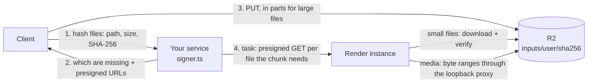

# Large inputs: multipart uploads and reading by range

The examples bake their media into the image. That is right for a composition with a logo and a sound track. It is
wrong for a service where every render brings its own recordings: an image per render is slow to build and slow to
start, and a 2 GB file does not belong in a request body.

This page is the pattern the prototype of this design used for inputs, and the helpers for it in `packages/core`.
The helpers are unit-tested against a small S3 in memory. **They are not wired into the examples and did not run
against R2 in this repository.**



## Address inputs by their content

Store an input under the SHA-256 of its bytes: `inputs/<user>/<sha256>`. The client hashes its files and asks which
hashes are not there yet. Only those are uploaded.

- A second render with the same footage uploads nothing.
- A project with 90 clips cut from a few recordings uploads the recordings once. In the prototype a 1.74 GB package of
  106 files was 22 distinct files and 0.12 GB.
- The key is the checksum: whoever downloads the object knows what its hash must be.

## Upload in parts, straight to the bucket

`packages/core/src/multipart.ts`:

```ts
import { uploadMultipart } from './packages/core/src/multipart.ts';

await uploadMultipart({
  path: '/recordings/interview.mov',
  key: `inputs/${user}/${sha256}`,
  // your service returns one presigned URL per call; the client never sees a key
  sign: (call) => fetch(`${service}/sign`, { method: 'POST', headers: auth, body: JSON.stringify(call) }).then((r) => r.text()),
  onProgress: ({ bytesDone, bytesTotal }) => bar.update(bytesDone / bytesTotal),
});
```

What it does, and why:

| Step | Detail |
| --- | --- |
| Plan the parts | Equal parts (R2 requires that, except for the last), at least 5 MiB, at most 10,000. Default 32 MiB |
| Find an interrupted upload | `ListMultipartUploads` with the key as prefix returns the upload id of an earlier try. No state file on the client: a client that crashed, or was reinstalled, resumes |
| Ask what arrived | `ListParts` returns number, size and ETag of every part the store has |
| Keep or resend | A listed part is kept only when its size is right **and** its ETag equals the MD5 of the local bytes. For S3 and R2 the ETag of a part is the MD5 of its body. A file that changed between two tries gets its changed parts sent again |
| Send the rest | A few parts at a time (4), one part in memory per connection, `Content-Length` set (S3 and R2 answer 411 to a chunked body). The ETag in each answer must equal the MD5 computed while reading. A fresh URL is asked for before each retry: the first one may have expired in a long queue |
| Complete | The object's ETag must be the composite ETag: the MD5 of the parts' binary MD5s, then `-<parts>`. A `200` answer to "complete" can still carry an `<Error>` body, so the body is read |

Use a single PUT below about 90 MB (`putFile()` in `transfer.ts` checks its ETag the same way) and parts above.
Hash with SHA-256 once per file and cache `{ path, size, mtime } -> sha256` on the client; MD5 is only computed per
part while it is sent.

The policy behind `sign` is `packages/core/src/signer.ts`: a user may sign calls for `inputs/<their id>/<sha256>` and
for their own job's prefix, and nothing else ([r2.md](r2.md#sign-as-little-as-possible)). It allows exactly the calls
above, including the bucket-level `ListMultipartUploads`, but only with a prefix that is one input object of that
user.

When the upload is complete, have the service verify it before a render starts: `HEAD` the object, compare the size,
and compare the ETag with the composite ETag computed from the part list.

## Read media by range, not by file

A browser that shows frame 9,000 of a recording does not read the file. It reads the container index and the samples
around that frame, with HTTP `Range` requests. A chunk in the middle of a long recording needs a few megabytes of it.

Measured in the prototype: a 10 s chunk in the middle of a 1.1 GB file fetched 26 to 30 MB, about 2.5 % of the file.
Fetching the inputs a chunk needs took 0.32 s (median) on an instance.

So do not download media to the instance. Give the page a URL it can read ranges from. A presigned GET would do, but
it puts a credential into the page and into every log line the browser writes. `packages/core/src/range-proxy.ts` is a
small proxy on the loopback interface instead:

```ts
import { startRangeProxy } from './packages/core/src/range-proxy.ts';

// in the engine's prepare hook, before the browser opens
const proxy = await startRangeProxy({
  'media/interview.mov': { url: presignedGetUrl, size: 1_181_116_006, contentType: 'video/quicktime' },
});
render.inputProps = { ...render.inputProps, video: proxy.urlFor('media/interview.mov') };   // http://127.0.0.1:<port>/media/interview.mov
// ... render ...
console.log(proxy.stats().perFile);     // { 'media/interview.mov': { size, upstreamBytes, upstreamRequests } }
await proxy.close();
```

How it keeps the traffic small:

- Requests are answered from fixed-size blocks (1 MiB). A block is fetched once, kept in a small LRU cache (96 MiB)
  and shared by every reader of the file: the picture and the sound of a clip read the same blocks.
- A sequential reader gets one block of read-ahead in the same upstream request.
- A reader that asks for "the rest of the file" and leaves after a megabyte does not make the proxy fetch on.
- Upstream requests are retried with backoff.

What it cannot do: compare a range with the file's SHA-256. It checks that the object's size is the recorded size and
relies on TLS. So split the inputs:

| Input | How |
| --- | --- |
| Small files: fonts, images, JSON, short sounds | download whole, verify size and SHA-256 (`downloadVerified()` in `transfer.ts`) |
| Large video and audio | by range through the proxy |

And tell each chunk only about the files it needs. If the service knows which media is visible in which frame range
(the prototype computes that once per job, padded by a second or two because media is mounted a little early and
audio is rendered a few AAC frames past a chunk's end), a chunk's task carries URLs for exactly those.

## Downloads

The same ideas apply to the client fetching a multi-gigabyte output over a presigned URL:

- Fetch several ranges at once and write them at their offsets into `<target>.download`.
- Keep `{ size, sha256, pieceSize, done: [index] }` in a file next to it, so that a download that stops resumes with
  the missing pieces.
- Give the file its name only after the SHA-256 of the whole file matched. On a mismatch delete both: the wrong range
  is unknown.
- A `403` on a range means the URL expired: ask for a new one and continue.

This repository's client (`downloadOutput()` in `packages/core/src/client.ts`) streams the output in one request and
checks the hash; that is enough for the sizes it was run with. The ranged, resumable download is not built here.
