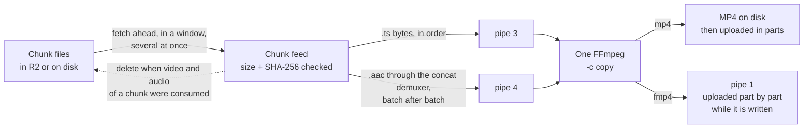

# Long videos: a streaming join

A short video is joined the simple way: every chunk on the disk of one instance, `combineChunks()`, one output file.
For a long video that stops working, and not because of time. This page says where it stops and what to do instead.

## Where the simple join stops

The joining instance holds **the chunks and the output at the same time**. A `standard-4` instance has 20 GB of disk,
about 19.2 GB as a filesystem, of which the image and the system use a few.

Measured in the prototype of this design (Cloudflare `standard-4`, 2026-11-27 and 28, one hour of 1080p30 at about
9.6 Mbit/s): 3.83 GB of chunks + 3.72 GB of output, and a disk peak of 11.46 GB used of 19.2 GB with 3.8 GB of image
and system. A guard computed from that refused anything above about 85 minutes of 1080p.

Two more things bite before the disk does:

- **Many small objects.** With chunks in object storage, the join first downloads them. One chunk is two files
  (`.ts` and `.aac`). 600 chunks were 1,200 files and took 44.9 s to fetch; 1,800 chunks were 3,600 files and took
  159.9 s. With 2 s chunks the render got faster (234 s to 127 s) and the whole job did not (336 s to 340 s): the
  fetch ate the gain.
- **One upload.** A multi-gigabyte output is uploaded after the join, in one go.

## The streaming join

`fleet.stitch: 'stream'` (CLI: `--stitch=stream`) joins without ever holding all chunks:



It does exactly what `combineChunks()` does for H.264 with AAC, in another order of time:

| Step | `combineChunks()` | Streaming |
| --- | --- | --- |
| Video | hands FFmpeg `concat:chunk0.ts\|chunk1.ts\|...`: the concat protocol, a plain sequential read of the files as one MPEG-TS stream | writes the same bytes into a pipe (`-f mpegts -i pipe:3`), chunk after chunk, as they arrive |
| Audio | FFmpeg's concat demuxer over all padded `.aac` files, with an `inpoint` and `outpoint` per file that cut off the extra AAC frames Remotion rendered on both sides (`forSeamlessAacConcatenation`) | the same demuxer with the same in and out points, over one batch of chunks after the other. The points depend only on a chunk's index, so the batches can simply be appended (`-f aac -i pipe:4`) |
| Mux | `-c:v copy -c:a copy -r <fps>`, Remotion's metadata comment, `-movflags faststart` | the same, by the same FFmpeg binary (Remotion's own) |

The pieces:

- `packages/core/src/chunk-feed.ts`: fetches chunks ahead of the join, several at a time on keep-alive connections,
  but never more than a window of bytes (768 MiB by default, `RENDER_STITCH_WINDOW_MIB`; 16 downloads at once,
  `RENDER_STITCH_FETCH_PARALLEL`). Each file is compared with its recorded size and SHA-256 **before** the join is
  told it is ready. A chunk's files are deleted as soon as both its video and its audio were consumed.
- `packages/cloudflare-containers/container/streaming-stitch.ts`: the muxer, the two loops that feed it in order, the
  audio cut arithmetic (`audioCut()`), and a last check: the muxer's own frame count must equal the frames of the
  render, or the join is an error and not an output.
- `packages/core/src/transfer.ts`: the upload in parts.

### Two outputs

| | `stream` | `stream-fmp4` |
| --- | --- | --- |
| Output | a normal MP4, `moov` first (`faststart`). The same file `combineChunks()` writes | a fragmented MP4 (`frag_keyframe+empty_moov+default_base_moof`, fragments of at least 4 s). The same packets |
| Where it goes | to the instance's disk, then uploaded | to a pipe; with a bucket it is cut into equal parts and each part is uploaded as soon as it is full |
| Disk peak | output + fetch window | fetch window only |
| Limit | the output must fit the disk | the multipart upload: 10,000 parts times the part size |
| Players | everything | players that read fragmented MP4. The duration is known only after the fragments were read, and the container's audio duration field reads a few hundredths of a second longer than the samples |

Use `stream` whenever the output fits the disk. `stream-fmp4` is for what does not. Without a bucket `stream-fmp4`
still works and writes the fragmented file to disk, which has no advantage; it exists so that the path can be
tested locally.

### The limits, computed

For `standard-4`: 19.2 GB of filesystem, about 3.8 GB of image and system (the prototype's image; measure yours with
`df` in a running instance), a 768 MiB window and 1 GB of margin leave about **13.5 GB for an output** in `stream`
mode.

| Video | Bytes per hour | `combine` | `stream` | `stream-fmp4` |
| --- | --- | --- | --- | --- |
| 1080p at 10 Mbit/s + 320 kbit/s audio | about 4.4 to 4.6 GB (4.40 measured) | about 85 minutes | about 3 hours | bound by the upload: 10,000 parts of 64 MiB are about 670 GB |
| 4K at 35 Mbit/s | about 16 GB | about 24 minutes | about 50 minutes | the same |

A guard for your own service: `estimatedBytes = (videoBitrate + audioBitrate) / 8 x seconds x 1.05`. Choose `stream`
when that is under 13 GB and `stream-fmp4` above.

### What was verified, and where

| Check | Where it ran | Result |
| --- | --- | --- |
| Same file as `combineChunks()` | this repository, macOS (and a CI step): real Remotion chunks of the example, joined three ways from the same files, one audio file per demuxer run (`packages/cloudflare-containers/scripts/compare-joins.ts`) | the `stream` MP4 is byte for byte the `combineChunks()` file; the `stream-fmp4` file has the same video and audio packets |
| The same with a frame range | this repository, macOS (frames 45 to 134 of the example, 3 chunks) | same file as `combineChunks()` |
| Batches do not change the audio | this repository, unit test with the system FFmpeg and synthetic chunks, batch sizes 1 and 3 | same packets as one run over all files |
| Chunks fetched from a store, checked, deleted behind the join; output streamed in parts | this repository, macOS (and a CI step), against an S3 stand-in in memory (`packages/core/test/e2e-storage.ts`) | frames, joins and sound verified |
| Same packets as `combineChunks()` | the prototype, its own implementation of the same join | byte-identical packets |
| Disk peak on a long video | the prototype, on a Mac with a local store: 2.5 hours of 1080p from real 5 s chunks (1,800 chunk objects, 11.31 GB in, 270,000 frames, 9000.000 s of video, 9000.043 s of audio) | MP4: 11.01 GB out in 329 parts of 32 MiB, 98.5 s, disk peak **11.51 GB** (0.49 GB that is not the output). Fragmented MP4: 328 parts, 70.9 s, disk peak **0.83 GB**. The join with every chunk on disk needed 22.3 GB for this job. The transfer times say nothing about R2: the store was on the same disk |

**Not run:** the streaming join on Cloudflare in this code base; any video longer than 90 frames with this
repository's code; `stream-fmp4` against real R2. The numbers for long videos are the prototype's.

## One object per chunk

Object count is what made short chunks slow to join (above). Half of it is avoidable: a chunk's `.aac` is small and
is always fetched together with its `.ts`. Write them as one object, the `.ts` bytes followed by the `.aac` bytes,
and record both lengths with the chunk. A sketch:

```ts
// in the container, after the render: one object per run of a chunk
const [video, audio] = [await readFile(tsPath), await readFile(aacPath)];
await putFile(url, await writeBoth(binPath, video, audio), info);          // chunk-0003-r2.bin
return { tsBytes: video.length, aacBytes: audio.length, sha256, md5 };     // goes into the task result

// in the join: the video loop reads bytes 0..tsBytes-1 into the muxer,
// the audio loop reads tsBytes..end into the file the concat demuxer is given
createReadStream(binPath, { start: 0, end: chunk.tsBytes - 1 });
```

That halves the requests, the signatures, and R2's class A and class B operations. The prototype does this. This
repository keeps two files per chunk, because `combineChunks()` wants two files and `combine` is still the default.

## Fetching many small objects

Whichever layout you choose:

- Fetch in parallel on keep-alive connections. The prototype's join fetches 48 objects at once by default; this
  repository 16, a number that was not tuned on Cloudflare.
- Bound the read-ahead by bytes, not by count. Chunks differ a lot in size.
- Always let the chunk the join is waiting for start, whatever the window says. Otherwise one chunk larger than the
  window stops the join for ever.
- Verify before feeding. A chunk that is wrong must fail the join before its bytes are in the output.

## Choosing

| Your video | Use |
| --- | --- |
| Up to tens of minutes, output of a few GB | `combine` (default). It is Remotion's own function and the path that ran on Cloudflare here |
| Chunks + output would not fit the disk, the output alone would | `stream` |
| The output alone would not fit | `stream-fmp4` with a bucket |
| Not H.264 | none of this: other codecs render in one piece on one instance |

```bash
node packages/cloudflare-containers/bin/remotion-cloudflare.mjs render MyComp --concurrency=4 --stitch=stream --out=out/long.mp4
```
